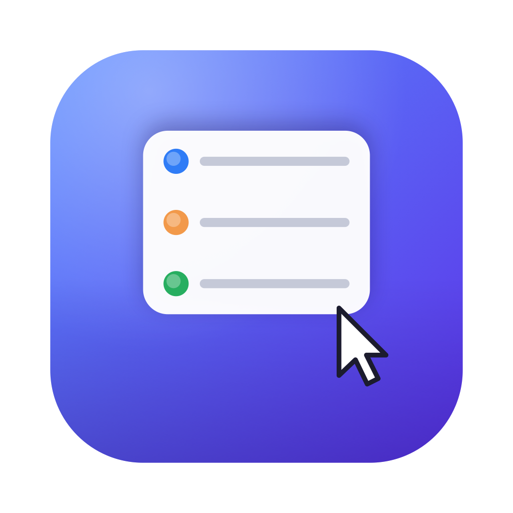

# Profile Picker

<p align="center"></p>

<p align="center"><a href="https://github.com/ondrej-li/ppicker/actions/workflows/ci.yml"></a></p>

Open every link in the right browser **profile**.

## Download

[**Download the latest release**](https://github.com/ondrej-li/ppicker/releases/latest), open the
DMG and drag **Profile Picker** onto the Applications folder. Requires **macOS 26** or later.

The download is signed with a Developer ID certificate and notarized by Apple. It runs outside the
App Sandbox, so browser profiles work directly and no helper script is needed. The App Store build is
sandboxed and uses the optional helper instead.

Profile Picker is a small macOS app that you set as your default browser. When you click a link in any app, Profile Picker either opens it straight away according to your rules ("links from Slack open in Brave, *Work* profile") or shows a picker next to the mouse so you can choose a browser and profile.

- Works with Chromium browsers' profiles (Chrome, Brave, Edge, Vivaldi, Chromium) and with any other browser (Safari, Firefox, …) as a whole.
- Rules match on the **app the link was clicked in**, the **host**, or the **whole URL**, using `*` wildcards.
- When no rule matches: show the picker, open a specific profile, or open the link the way that browser normally would.
- The picker is keyboard friendly: `1`–`9` to choose, arrows and Return, `⌘C` to copy the link, Esc to cancel. Hold **⌥ Option** while clicking a link to always get the picker.
- "Always for github.com" (and similar) in the picker creates a rule for you.
- Export and import rules and settings as a JSON file, to move them between Macs or keep a backup.
- Native SwiftUI + AppKit, Liquid Glass, macOS 26 or later. No network access, no analytics.

The App Store listing name is **Profile Picker**. Bundle ID `cz.ondralinek.ppicker`, team `B592D69P29`.

## How browser profiles work

Chromium browsers open a link in a given profile when launched with `--profile-directory="Profile 1"`.

**Developer builds need no helper.** Debug and Release builds from source run outside the App Sandbox,
so Profile Picker reads the browser's `Local State` file itself and runs
`open -n -a <browser> --args --profile-directory=<profile> <url>`. Build and run from Xcode and
profiles work straight away.

**The App Store build is sandboxed.** Mac App Store apps must run in the App Sandbox, and the sandbox
**strips command-line arguments** from apps it launches and **blocks reading** other apps' data (such
as the browser's list of profiles). macOS's sanctioned way out is a script in the app's own
*Application Scripts* folder (`~/Library/Application Scripts/<bundle id>/`). Such scripts run outside
the sandbox via `NSUserUnixTask`, but only the user can put them there. Profile Picker's settings
(Browsers ▸ *Install Helper…*) open that folder in a standard dialog; clicking *Install Helper*
writes [`profile-picker-helper.sh`](ProfilePicker/Core/Helper.swift) into it. The script can do
exactly two things:

| Command | What it does |
|---|---|
| `profiles <data dir> <output>` | Copies the `profile.info_cache` part of the browser's `Local State` file (profile folder names, display names, colors) using `plutil`. Nothing else is read. |
| `open <app> <profile> <url>` | Runs `open -n -a <app> --args --profile-directory=<profile> <url>`. |

Without the helper the App Store build still routes links between browsers, but cannot choose a
profile. Deleting the script is always safe.

## Building

Requirements: macOS 26, Xcode 26 or later, [XcodeGen](https://github.com/yonaskolb/XcodeGen) (`brew install xcodegen`).

```sh
xcodegen generate              # creates ProfilePicker.xcodeproj from project.yml
open ProfilePicker.xcodeproj
```

`project.yml` already carries the bundle ID and team. Debug and Release use
[`ProfilePicker-Developer.entitlements`](ProfilePicker/ProfilePicker-Developer.entitlements) and run
**unsandboxed**, which is why they need no helper. The `AppStore` configuration uses
[`ProfilePicker.entitlements`](ProfilePicker/ProfilePicker.entitlements) and the sandbox.

Command line (ad-hoc, no team needed):

```sh
xcodebuild -scheme ProfilePicker -derivedDataPath build \
  CODE_SIGN_IDENTITY=- CODE_SIGN_STYLE=Manual DEVELOPMENT_TEAM= build
xcodebuild -scheme ProfilePicker -derivedDataPath build \
  CODE_SIGN_IDENTITY=- CODE_SIGN_STYLE=Manual DEVELOPMENT_TEAM= test
open "build/Build/Products/Debug/Profile Picker.app"
```

To try it without changing your default browser: `open -a "build/Build/Products/Debug/Profile Picker.app" https://example.com`

To run the sandboxed App Store build locally:

```sh
xcodebuild -scheme ProfilePicker -configuration AppStore -derivedDataPath build \
  CODE_SIGN_IDENTITY=- CODE_SIGN_STYLE=Manual DEVELOPMENT_TEAM= build
```

## Releasing

### Direct download (GitHub release)

```sh
scripts/package.sh
```

This archives the **Release** configuration, signs it with a Developer ID certificate, submits it to
Apple's notary service, and writes a drag-to-Applications
`build/ProfilePicker-<version>.dmg`, a `.zip`, and SHA-256 checksums. The Xcode account signed in to
team `B592D69P29` does the signing and notarization; no separate notary credentials are needed.

Create the public release after the script finishes (adjust the version and notes file):

```sh
gh release create v1.0.0 --title "Profile Picker 1.0.0" \
  --notes-file Packaging/release-notes-1.0.0.md \
  build/ProfilePicker-1.0.0.dmg build/ProfilePicker-1.0.0.zip build/ProfilePicker-1.0.0-SHA256SUMS.txt
```

### App Store / TestFlight

```sh
scripts/release.sh               # archive + export to build/export/Profile Picker.pkg
scripts/release.sh --upload      # also upload to App Store Connect with the Xcode account
```

The script archives the **AppStore** configuration (sandboxed). Bump `CURRENT_PROJECT_VERSION` in
[`project.yml`](project.yml) before each upload. The archive is signed with the Apple Distribution
certificate and the *Mac Team Store* provisioning profile for `cz.ondralinek.ppicker`; the exported
package is what TestFlight receives.

`APPSTORE.md` has the App Store fields, privacy answers, screenshots, review notes and the steps to
create the app record (required before the first upload).

### CI

- [`.github/workflows/ci.yml`](.github/workflows/ci.yml) builds and tests on every push and pull request on a `macos-26` runner.
- [`.github/workflows/testflight.yml`](.github/workflows/testflight.yml) archives, exports and optionally uploads to TestFlight on a `testflight-v*` tag or manually. It needs these repository secrets: `ASC_KEY_ID`, `ASC_ISSUER_ID`, `ASC_PRIVATE_KEY`, `BUILD_CERTIFICATE_BASE64`, `P12_PASSWORD`, `KEYCHAIN_PASSWORD`.

## Project layout

| Path | |
|---|---|
| `ProfilePicker/App/AppDelegate.swift` | Receives links (`kAEGetURL` Apple Event), works out the source app, routes the link; menu bar item; settings window |
| `ProfilePicker/App/AppState.swift` | Settings (saved as JSON in the app container), default-browser status, launch at login |
| `ProfilePicker/Core/RuleEngine.swift` | Rule matching and wildcards (pure, unit tested) |
| `ProfilePicker/Core/SettingsDocument.swift` | Versioned JSON export/import envelope for settings |
| `ProfilePicker/Core/Profiles.swift` | Known Chromium browsers and their data folders; `Local State` parsing |
| `ProfilePicker/Core/BrowserCatalog.swift` | Finds installed browsers and their profiles |
| `ProfilePicker/Core/Helper.swift` | The helper script, its installation, and running it |
| `ProfilePicker/Core/DirectAccess.swift` | Direct profile reading and launching for unsandboxed developer builds |
| `ProfilePicker/Core/Launcher.swift` | Opens a link in a browser/profile; resolves the app a link came from |
| `ProfilePicker/UI/Picker.swift` | The floating picker panel |
| `ProfilePicker/UI/Settings/` | Settings window: General, Browsers, Rules |
| `ProfilePicker/Assets.xcassets` | App icon and menu bar icon |
| `ProfilePicker/PrivacyInfo.xcprivacy` | Privacy manifest |
| `scripts/make-icon.swift` | Redraws the icon artwork into the asset catalogue and `AppStore/` |
| `scripts/release.sh` | Archive, export and optional TestFlight upload |
| `scripts/package.sh` | Developer ID-signed, notarized DMG and zip for direct download |
| `Packaging/` | DMG Read Me and GitHub release notes |
| `APPSTORE.md` | App Store Connect copy, review notes and checklist |

### Adding a Chromium browser

Add its bundle identifier and data folder (relative to `~/Library/Application Support`) to `KnownBrowsers.chromiumDataDirectories` in [`Profiles.swift`](ProfilePicker/Core/Profiles.swift). Pull requests welcome.

### Changing the icon

Edit the drawing code in [`scripts/make-icon.swift`](scripts/make-icon.swift), then run:

```sh
xcrun swift scripts/make-icon.swift
```

It rewrites the `AppIcon` and `StatusIcon` asset sets and `AppStore/AppIcon-1024.png`.

## How the source app is detected

The `GetURL` Apple Event carries the sender's process ID. Profile Picker maps it to the app, and maps helper processes (for example `Slack Helper.app`) to the app that contains them. When the sender isn't an app (for example `open https://…` in a terminal), Profile Picker uses the frontmost app.

## Privacy

Profile Picker makes no network requests and collects nothing. The App Store build stores your rules in `~/Library/Containers/cz.ondralinek.ppicker/Data/Library/Application Support/config.json`; the direct-download build stores them in `~/Library/Application Support/config.json`. Links are logged to the system log only with their URL redacted. See [PRIVACY.md](PRIVACY.md).

## License

MIT, see [LICENSE](LICENSE).
